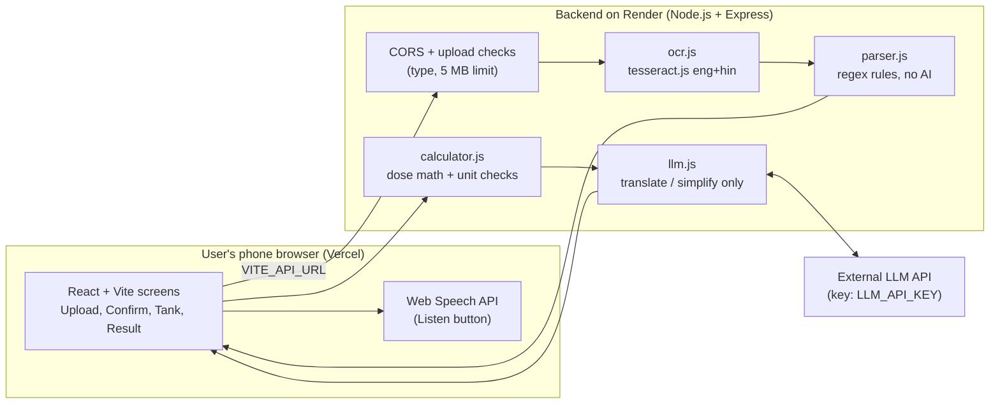
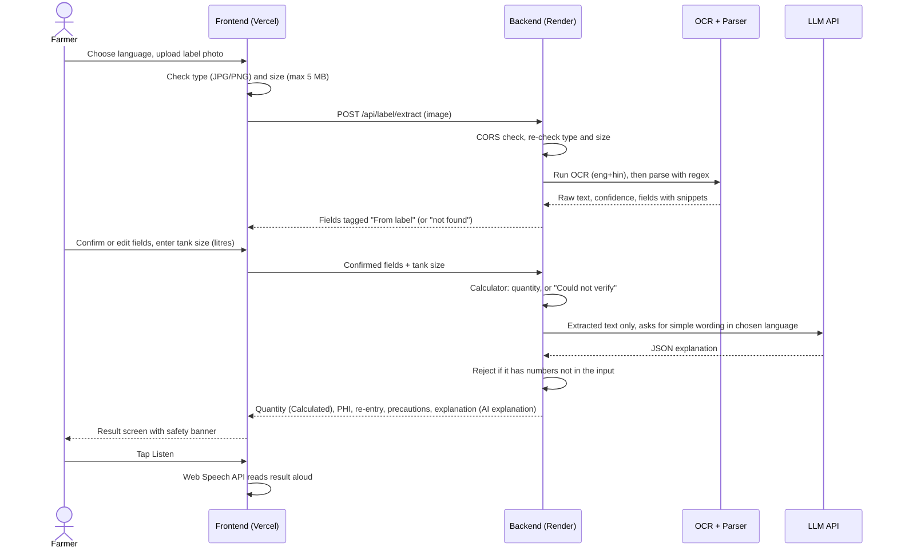

# Pesticide Label Reader for Indian Farmers

A phone-friendly web app that reads a **photo of a pesticide label** and shows:

- how much product to put in **your** spray tank
- the **pre-harvest interval (PHI)** — how many days to wait after spraying before harvest
- **safety steps**, in English or Hindi
- a **Listen** button that reads the result aloud

**This is a helper, not an official instruction.** Follow the product label and local regulations. If the label is unclear, contact your agri-input shop or agriculture office.

The app **never invents** a dose, waiting period, or precaution. If a number is missing from the label, it says **Could not verify**.

---

## Words you will see in this README

| Term | Plain meaning |
| --- | --- |
| Frontend | The screens in the browser (buttons, photos, results). Folder: `frontend/`. |
| Backend | A small server that reads the photo and does the math. Folder: `backend/`. |
| API | The backend’s URL endpoints, like `/api/health`. The frontend calls them. |
| OCR | Optical character recognition — software that turns a photo of text into actual text. |
| PHI | Pre-harvest interval: days to wait after spraying before harvest. |
| Re-entry interval | Time to wait before people go back into the sprayed field. Different from PHI. |
| Environment variable | A setting stored outside the code, such as a secret key or a server URL. |
| CORS | A browser safety rule: the backend only answers websites you list. |
| Vite | The tool that runs the React frontend while you develop (`localhost:5173`). |
| Express | The Node.js library that runs the backend. |
| Vercel | Free hosting for the frontend. |
| Render | Free hosting for the backend. |

---

## How it works (overview)

1. You choose English or Hindi.
2. You upload or photograph a label (JPG or PNG, max 5 MB).
3. The backend reads the photo with **tesseract.js** (OCR, English + Hindi).
4. The backend **parses** (extracts) product name, rate, PHI, re-entry, and precautions with rules — not AI.
5. You **confirm or edit** those fields.
6. You enter tank size in litres.
7. The app **calculates** tank quantity only when the label rate, unit, and tank size are all clear.
8. One AI call may **translate or simplify** the extracted text. It must not add new numbers.
9. The browser can **read the result aloud** (Web Speech API — no extra key).

Demo photos are always marked **DEMO LABEL**. Never treat them as a real product you should spray.

---

## Architecture

The app has two parts that talk over HTTPS: a **frontend** (what the user sees) and a **backend** (where the reading, parsing, math, and AI call happen). There is no database and no login.



### What each part does

| Part | File / tool | Job | Uses AI? |
| --- | --- | --- | --- |
| Screens | `frontend/src/components/` | Upload, confirm fields, tank input, result, safety banner, language select | No |
| API client | `frontend/src/services/api.js` | Calls the backend using `VITE_API_URL`; shows the "Starting the server..." message on slow first requests | No |
| Speech | `frontend/src/services/speech.js` | Reads the result aloud with the browser's Web Speech API | No |
| Server entry | `backend/src/server.js` | Express app, `GET /api/health`, CORS allow-list, upload limits, `PORT` | No |
| Route | `backend/src/routes/label.js` | `POST /api/label/extract` (photo in, text and fields out) | No |
| OCR | `backend/src/services/ocr.js` | Turns the photo into text and a confidence score | No (classic OCR) |
| Parser | `backend/src/services/parser.js` | Finds product name, rate and unit, tank instructions, PHI, re-entry, precautions. Each field returns the matched snippet and found / not found | No (regex) |
| Calculator | `backend/src/services/calculator.js` | Computes the tank quantity only when rate, unit, and tank size are clear. Otherwise returns "Could not verify" | No (plain math, unit-tested) |
| LLM | `backend/src/services/llm.js` | Translates and simplifies the extracted text. Output is rejected if it contains a number not in the input | Yes, the only place |

### Why it is split this way

Each job goes to the most reliable tool for it. Reading text is OCR's job, finding values is a fixed set of rules, math is code, and only wording is left to AI. This keeps the AI away from anything that could cause a wrong dose.

### Trust boundaries

| Where | What is allowed | What is not |
| --- | --- | --- |
| Frontend / browser | Public settings such as `VITE_API_URL` | Secrets. Anything starting with `VITE_` is visible to users |
| Backend | Reads `LLM_API_KEY` from `process.env` | Accepting requests from origins not in `ALLOWED_ORIGINS` |
| LLM output | Simpler wording of text from the label | New numbers, products, or precautions |

---

## Data flow

This is what happens from the moment a farmer takes a photo to the moment the result is read aloud.



### Step by step

1. **Select language.** English or Hindi, kept in the frontend's component state.
2. **Upload photo.** The frontend checks type and size first for a quick message. The backend checks again, because the frontend alone can be bypassed.
3. **OCR.** `ocr.js` returns raw text and a confidence score. Low confidence or missing text is shown to the user, never hidden.
4. **Parse.** `parser.js` extracts each field with the matched snippet. Missing fields come back as "not found", never guessed. PHI and re-entry interval stay separate.
5. **Confirm.** The user checks and edits product name, rate, unit, PHI, and precautions. Nothing is calculated before this step.
6. **Tank size.** The user enters litres. It must be a positive number, at most 10,000.
7. **Calculate.** `calculator.js` works only when the rate with unit, tank size, and user confirmation are all present. Original units are kept, and any conversion is shown on a separate line.
8. **Explain.** `llm.js` sends only the extracted text to the LLM and asks for strict JSON. If the output has a number that was not in the input, it is thrown away. If the call fails or no key is set, the app shows the extracted English summary plus an error message, never mock text.
9. **Show result.** Every item carries a source tag: **From label**, **Calculated**, or **AI explanation**. The helper disclaimer is on every result screen.
10. **Listen.** The browser reads the result aloud. If the browser does not support it, a message says so.

### Source tags and where each value comes from

| Value on the result screen | Produced by | Tag |
| --- | --- | --- |
| Product name, rate, unit, PHI, re-entry, precautions | `ocr.js` then `parser.js`, then confirmed or edited by the user | From label |
| Tank quantity | `calculator.js` (label rate x tank size) | Calculated |
| Simplified or translated explanation | `llm.js` | AI explanation |

### How failures behave

| Problem | What the user sees |
| --- | --- |
| Wrong file type or file over 5 MB | A clear message, request rejected |
| Blurry image or OCR failure | A message saying the text could not be read reliably |
| Rate missing | Quantity shows **Could not verify**, with no number |
| Tank size blank, zero, or negative | Rejected with a message |
| LLM slow, failing, or `LLM_API_KEY` empty | Extracted fields still show, plus an error message |
| First request after idle on free hosting | "Starting the server, this can take up to a minute" |
| Request from a non-allowed origin | Blocked by CORS |

### Demo mode

The **Use DEMO label** buttons send a sample image by filename. For those files the backend uses the known DEMO text, so the walkthrough is stable. Real camera photos always go through OCR. Demo results are always labelled **DEMO LABEL**.

---

## Folder map

```
Hacktober_project/
├── frontend/          React + Vite (Vercel)
├── backend/           Node.js + Express (Render)
├── demo/              Sample DEMO labels + expected fields
├── README.md
└── .gitignore
```

---

## Local setup (your Mac)

### 1. Install tools (once)

You need **Node.js LTS**, **npm**, and **Git**. Check:

```bash
node -v
npm -v
git --version
```

Vite needs Node **20.19+** or **22.12+**. If `node -v` is older, install a current LTS from [https://nodejs.org](https://nodejs.org) or, if you use nvm:

```bash
nvm install --lts
nvm use --lts
```

### 2. Copy the project

If you cloned from GitHub:

```bash
git clone <your-repo-url>
cd Hacktober_project
```

### 3. Backend environment file

An **environment file** (`.env`) holds settings that are not in the code.

```bash
cd backend
cp .env.example .env
```

Open `backend/.env` and keep:

```
PORT=3001
ALLOWED_ORIGINS=http://localhost:5173
LLM_API_KEY=
```

`LLM_API_KEY` can stay empty for now. **Do not commit `.env`.**

### 4. Frontend environment file

```bash
cd ../frontend
cp .env.example .env
```

Keep:

```
VITE_API_URL=http://localhost:3001
```

`VITE_API_URL` is the backend address. Names starting with `VITE_` are visible in the browser, so **never put secrets there**.

### 5. Install packages

`npm install` downloads libraries listed in `package.json` into `node_modules/` (ignored by Git).

There is **no app** in the repo root besides helper scripts. The yellow prompt `Hacktober_project` is the root. If you run `npm run dev` or `npm run build` **here** before installing the root helper, npm looks for a root `package.json` and errors with `ENOENT`. After the commands below, `npm run dev` from the root starts **both** apps.

From the project root:

```bash
npm run setup
```

That installs root helpers, `backend/` packages, and `frontend/` packages.

Or install each folder yourself:

```bash
npm install
cd backend && npm install
cd ../frontend && npm install
```

### 6. Run both servers

**Easiest: one command from the project root**

```bash
cd Hacktober_project
npm run dev
```

This starts the backend on port **3001** and the frontend on port **5173**.

**Or two terminals**

Terminal A — backend (`npm run dev` restarts when you save a file). Folder name is `backend` (lowercase):

```bash
cd Hacktober_project/backend
npm run dev
```

Expected: `Backend listening on http://localhost:3001`

Check health (a tiny “is the server awake?” URL):

```bash
curl http://localhost:3001/api/health
```

Expected: `{"ok":true}`

Terminal B — frontend:

```bash
cd Hacktober_project/frontend
npm run dev
```

Expected: Vite prints `http://localhost:5173`. Open that in a browser.

To **build** the frontend (this is what Vercel runs), you must be in `frontend/` or use the root helper:

```bash
cd Hacktober_project
npm run build
```

---

## Environment variables

### Backend (`backend/.env` locally, Render dashboard in production)

| Name | Purpose |
| --- | --- |
| `PORT` | Which port the server listens on. Default `3001`. Render sets this for you. |
| `ALLOWED_ORIGINS` | Comma-separated frontend URLs allowed to call the API. Local: `http://localhost:5173`. Production: your Vercel URL. Never `*`. |
| `LLM_API_KEY` | Server-only key for the translation call. Never put this in frontend code or Vercel. |

### Frontend (`frontend/.env` locally, Vercel project settings in production)

| Name | Purpose |
| --- | --- |
| `VITE_API_URL` | Backend base URL. Local: `http://localhost:3001`. Production: your Render URL, for example `https://your-service.onrender.com` (no trailing slash). |

---

## Running tests

Calculator tests are added in Stage 5. When they exist:

```bash
cd backend
npm test
```

---

## Deployment (Stage 8 — summary)

Do **backend first**, then frontend, then update CORS.

### Render (backend)

1. Push this repo to GitHub.
2. On [Render](https://render.com), create a **Web Service** from the repo.
3. **Root directory:** `backend`
4. **Build command:** `npm install`
5. **Start command:** `npm start`
6. Environment: `LLM_API_KEY`, `ALLOWED_ORIGINS` (start with your local origin or a placeholder Vercel URL).
7. After deploy, open `https://YOUR-RENDER-URL/api/health` — you should see `{"ok":true}`.

The first request after idle time can be slow (**cold start**). The first OCR run is slower because language files download once.

**Verify current free-tier limits on Render’s pricing page before you demo.** They change. Do not assume hours or sleep rules from memory.

### Vercel (frontend)

1. Import the same GitHub repo on [Vercel](https://vercel.com).
2. **Root directory:** `frontend`
3. Environment: `VITE_API_URL` = the Render URL (no trailing slash).
4. Deploy. Copy the Vercel URL.

### After both exist

1. Set Render `ALLOWED_ORIGINS` to the exact Vercel URL (and keep `http://localhost:5173` if you still develop locally).
2. Redeploy the backend.
3. In the browser Network tab, confirm no `LLM_API_KEY` is sent from the frontend.

---

## Demo flow (3 steps, DEMO labels only)

1. Open `http://localhost:5173` (or the Vercel URL). Choose English or Hindi.
2. Tap **Use DEMO label (full)**. Confirm the fields (product, 2 ml per litre, PHI 7 days, re-entry 24 hours). Enter tank **16** litres. You should see **32 ml** tagged Calculated.
3. Tap **Listen**. Then retry with **Use DEMO label (no rate)** — quantity must say **Could not verify**, with no invented number.

Keep local setup working as a backup if Wi‑Fi or free hosting is asleep.

The **Use DEMO label** buttons send the sample PNG by filename. The backend uses the known DEMO text for those files so the walkthrough is stable; a real camera photo still goes through OCR.

---

## Known limitations

- OCR can fail on blurry, shiny, or tiny text. The app must say so, not guess.
- AI may be unavailable (`LLM_API_KEY` empty). Extracted fields should still show.
- Hosted backends on free tiers can sleep; the first click may wait up to a minute.
- Not a substitute for the printed label or an agriculture officer.

---

## Safety rules (always)

1. Never invent dose, dilution, PHI, re-entry, or precautions.
2. Tag every value: **From label**, **Calculated**, or **AI explanation**.
3. AI may only simplify/translate extracted text. Reject AI text that contains numbers not in the extraction.
4. Calculate tank quantity only with a clear rate, unit, tank size, and user confirmation.
5. Keep original units. Show conversions on a separate line.
6. PHI and re-entry are separate fields.
7. User must confirm/edit fields before calculation.
8. The helper disclaimer appears on every result screen.
9. Do not recommend mixing products unless the label says so.
10. Low OCR confidence must be stated.
11. Demo data is labelled **DEMO LABEL**.
